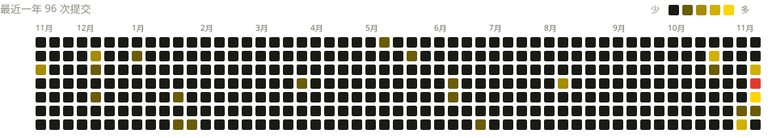

  

  
  

---

#### `项目清单`

<table width="100%">
  <tr>
    <th align="left" width="52">序号</th>
    <th align="left" width="320">项目名</th>
    <th align="left" width="380">项目说明</th>
    <th align="left" width="120">星标数</th>
  </tr>
  <tr>
    <td><code>01</code></td>
    <td><a href="https://github.com/Dontdrunk/ComfyUI-DD-Translation"><b>ComfyUI-DD-Translation</b></a></td>
    <td>面向最新版本 ComfyUI 的全面翻译与适配</td>
    <td>★ 848</td>
  </tr>
  <tr>
    <td><code>02</code></td>
    <td><a href="https://github.com/Dontdrunk/ComfyUI-DD-Nodes"><b>ComfyUI-DD-Nodes</b></a></td>
    <td>多 AI 协作开发的节点库</td>
    <td>★ 184</td>
  </tr>
  <tr>
    <td><code>03</code></td>
    <td><a href="https://github.com/Dontdrunk/Comfyui-EL-Launcher"><b>Comfyui-EL-Launcher</b></a></td>
    <td>ComfyUI 桌面启动器</td>
    <td>—</td>
  </tr>
  <tr>
    <td><code>04</code></td>
    <td><a href="https://github.com/Dontdrunk/ModuWeb-EasyPyEnv"><b>ModuWeb-EasyPyEnv</b></a></td>
    <td>可视化 Python 环境管理</td>
    <td>★ 34</td>
  </tr>
  <tr>
    <td><code>05</code></td>
    <td><a href="https://github.com/Dontdrunk/AgentEnvChecker"><b>AgentEnvChecker</b></a></td>
    <td>Windows Agent 环境诊断</td>
    <td>—</td>
  </tr>
</table>

---

#### `贡献图`

  

每日自动同步 · 红色为全年峰值日

